# Superstore Sales Dashboard

An interactive sales analysis and dashboard built in Microsoft Excel using the Superstore dataset. The project explores sales trends, products, customers, geography, and shipping performance from 2015 to 2018.

## Dashboard

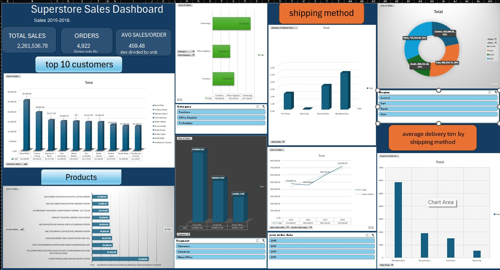

## Dataset

- **Source file:** data/superstore_sales.csv
- **Dataset size:** 9,800 sales records and 18 columns
- **Distinct orders:** 4,922
- **Period covered:** 2015–2018
- **Total sales:** $2,261,536.78

Each row represents a sales line item, so the number of records is greater than the number of distinct orders. The source CSV is included in the repository.

## Questions and Visualizations

### 1. What are the total sales, number of orders, and average sales per order?

Total sales were **$2,261,536.78** across **4,922 orders**, with average sales of **$459.48 per order**.

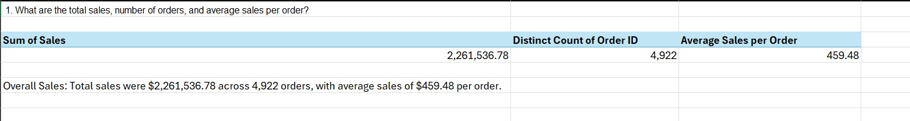

### 2. How do sales change by month and year?

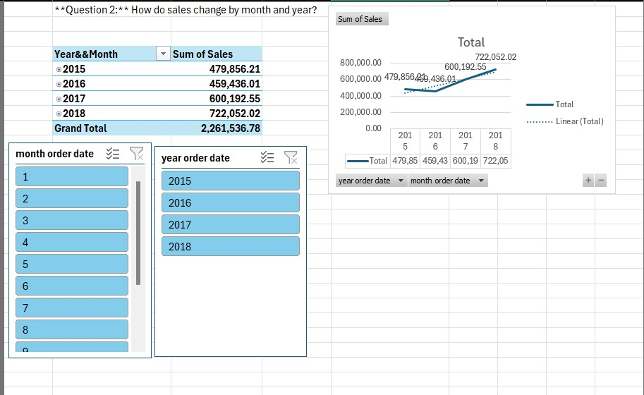

### 3. Which product categories and sub-categories generate the highest sales?

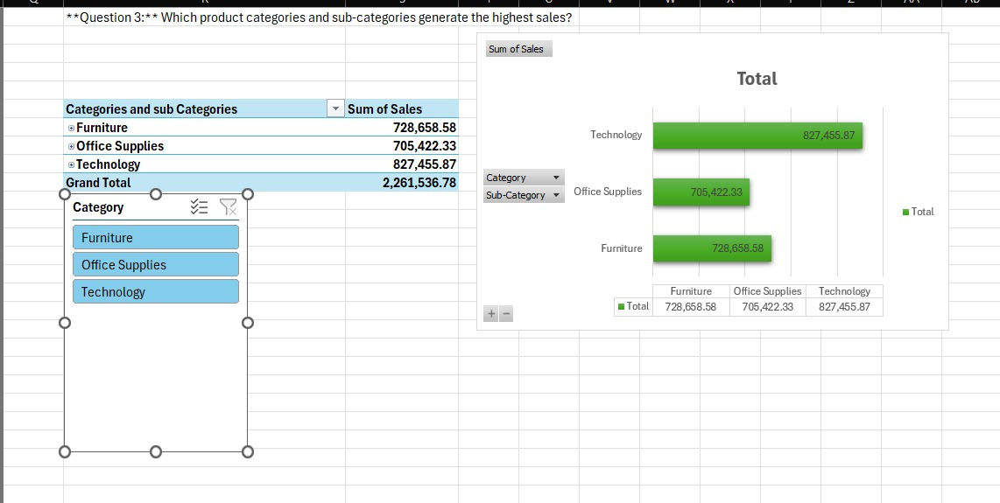

### 4. Which products have the highest total sales?

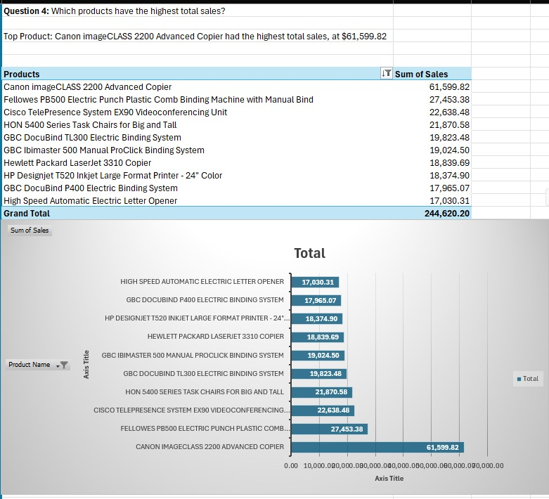

### 5. Which regions and states generate the highest sales?

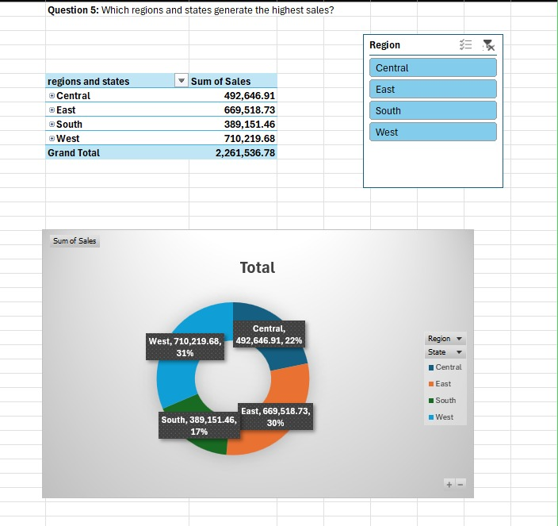

### 6. Which customer segments contribute the most to total sales?

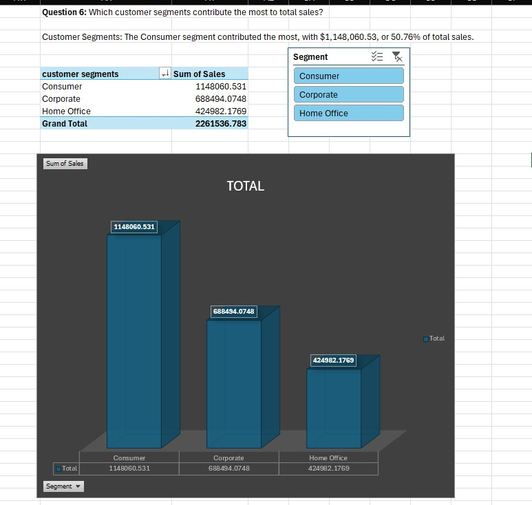

### 7. Who are the top 10 customers by total sales?

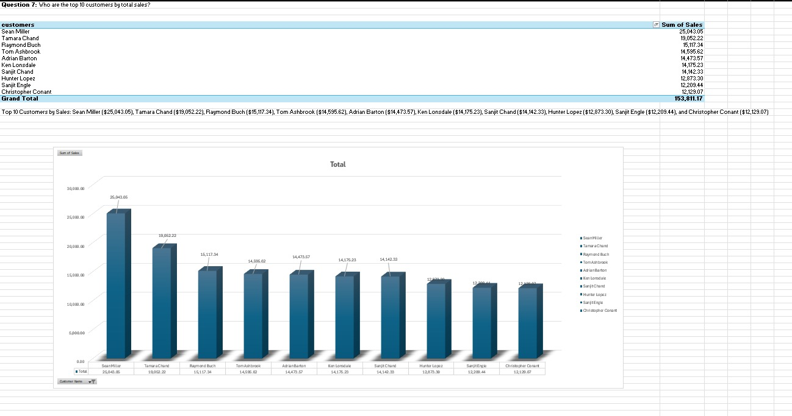

### 8. Which shipping method is used most often?

Standard Class appears on **5,859 sales records** in the chart. Counting distinct orders, it was used for **2,945 of 4,922 orders** (about **59.8%**).

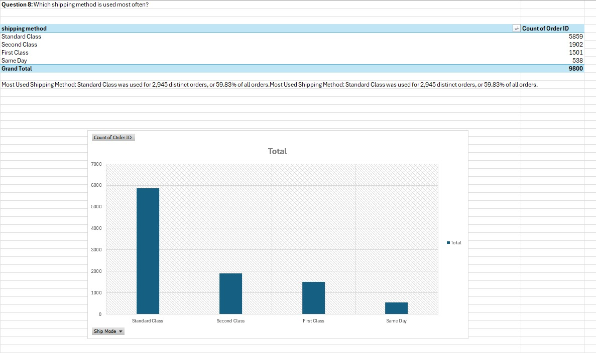

### 9. How does average delivery time vary by shipping method?

Average delivery time was **5.01 days** for Standard Class, **3.25 days** for Second Class, **2.18 days** for First Class, and **0.04 days** for Same Day.

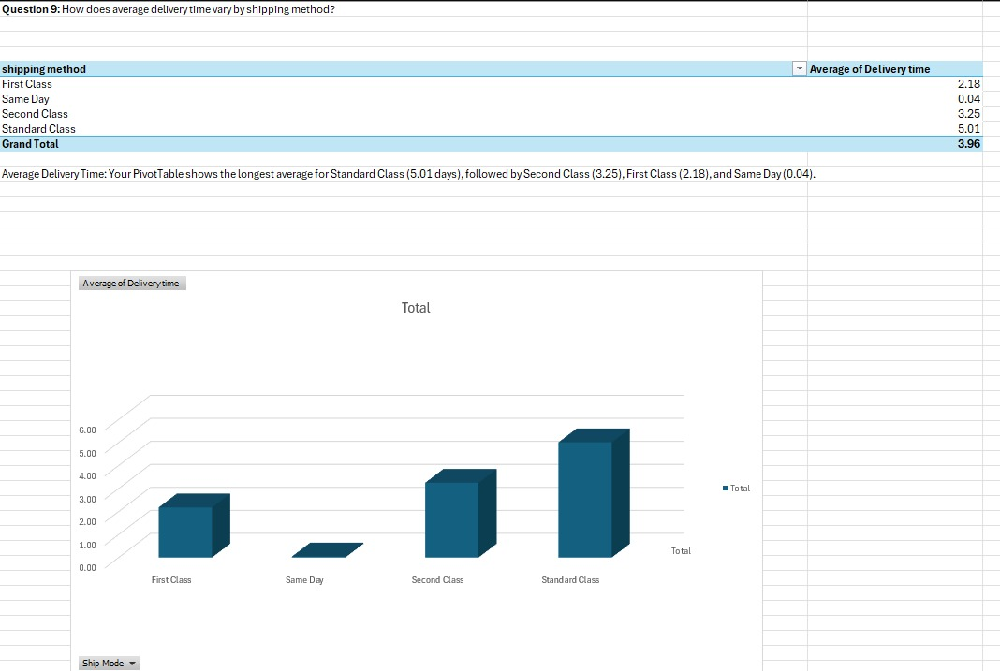

## Key Findings

- **Total sales:** $2,261,536.78 across **4,922 distinct orders**.
- **Average sales per order:** $459.48.
- **Top category:** Technology, with $827,455.87 in sales.
- **Top region:** West, with $710,219.68 in sales.
- **Top product:** Canon imageCLASS 2200 Advanced Copier, with $61,599.82 in sales.
- **Most-used shipping method:** Standard Class, used for **2,945 distinct orders**.
- **Average delivery time:** Standard Class had the longest average delivery time at **5.01 days**; Same Day had the shortest at **0.04 days**.

## Data Preparation

Power Query was used to prepare the data for analysis:

- Converted Order Date and Ship Date to date values.
- Added order year, month, and day fields for time-based analysis.
- Calculated delivery time from Ship Date minus Order Date.
- Created a delivery-speed group to compare shipping durations.

## Power Query Steps

The query's Applied Steps include loading the source, promoting headers, locale-aware type conversions, replacing values, adding a custom column, splitting and renaming date fields, adding a conditional column, and applying a final type conversion.

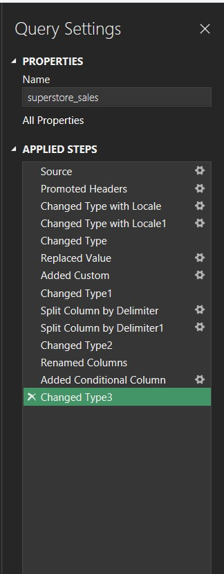

## Tools

- Microsoft Excel
- Power Query
- PivotTables
- PivotCharts
- Slicers

## How to Use

1. Download or clone the repository.
2. Open superstore_sales_dashboard.xlsx in the Excel desktop application.
3. If Excel cannot find the Power Query source, update the source path to data/superstore_sales.csv.
4. Select **Data → Refresh All** to refresh the queries and PivotTables.
5. Use the dashboard slicers to explore the data by year, region, category, and customer segment.

## Notes

- The question 8 chart shows counts of sales records (9,800 total). The distinct-order result is reported separately above, because the dataset contains multiple sales records per order.
- The supplied dataset contains sales but no profit field, so this project does not report profit or profit margin.
- These results describe patterns in the dataset and do not establish cause and effect.

## Repository Contents

- README.md — project overview, findings, and visualizations.
- superstore_sales_dashboard.xlsx — Excel workbook with the analysis and dashboard.
- data/superstore_sales.csv — source dataset.
- images/ — dashboard, question-by-question charts, and Power Query steps screenshot.
